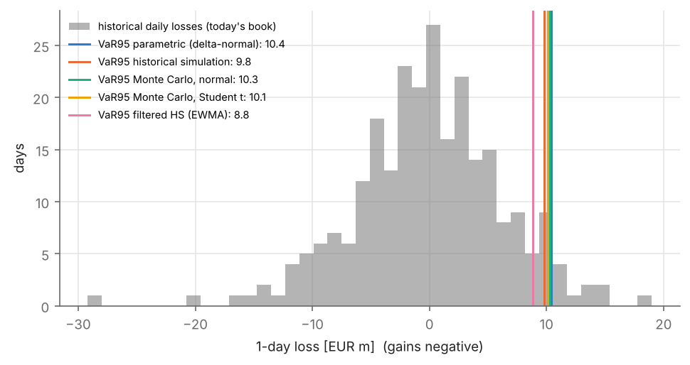
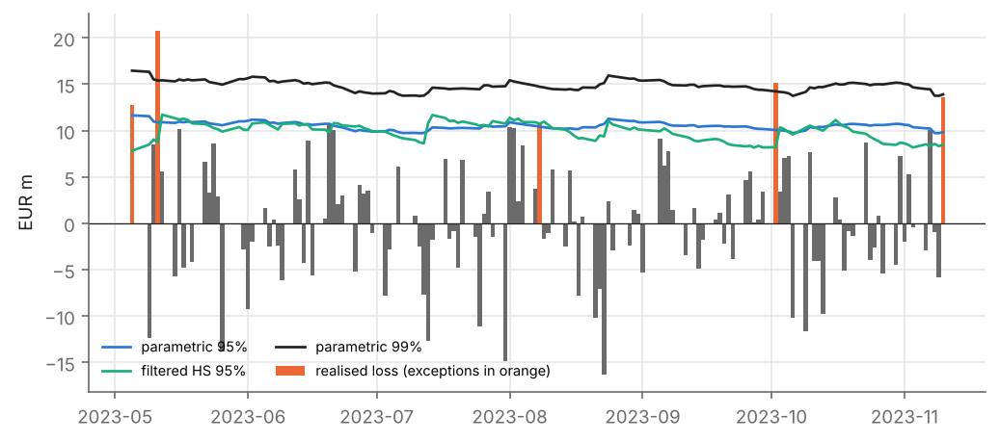

# Market risk of a commodity inventory: VaR and Expected Shortfall four ways

A German company holds 500 tonnes of silver. Silver is priced in US dollars, the company reports in euros, so the
euro value of the stock moves with the silver price **and** the exchange rate. This repository measures that risk
(Value at Risk and Expected Shortfall), extends it to a book of silver and copper, compares five methods and
backtests them. It is the worked-out version of an exercise of the course *Risikomanagement* (M.Sc. Optimization,
HSBI, winter term 2024/25). Report: [`report/report.pdf`](report/report.pdf).

## Findings (data: Nov 2022 - Nov 2023)

| | |
|---|---|
| **The exercise** | 1-day VaR(95 %) of 500 t of silver (EUR 334 m): **EUR 8.3 m** (2.5 %), ES(95 %) EUR 10.4 m. |
| **Natural hedge** | Silver and the euro rise together against the dollar (correlation +0.48). Ignoring it would overstate the VaR by 18 %. |
| **Methods** | Parametric, historical simulation, Monte Carlo (normal and Student t) and filtered historical simulation (EWMA) give 1-day VaR(95 %) between EUR 8.8 m and 10.4 m for the silver + copper book; they differ most in the tail (10-day ES(99 %): EUR 41-59 m). |
| **Diversification** | Silver and copper together: VaR 27 % below the sum of the stand-alone VaRs (Euler allocation in `results/contributions.csv`). |
| **Backtest** | All methods pass Kupiec and Christoffersen on 132 out-of-sample days. But with so few days, a 99 % model that fails twice as often as it should is rejected only 13 % of the time: a passed backtest is weak evidence. |
| **Backtest, 2016-2026** | On public data (2686 days), the backtest separates the methods: normal tails underestimate the 99 % VaR (45-48 exceptions instead of 27, Kupiec p ≤ 0.001), constant volatility gives clustered exceptions, and filtered historical simulation fits best (135 / 134 at 95 %, 33 / 27 at 99 %). Statistics in `results/public_snapshot/`. |





## Repository

```
src/invrisk/
  data.py         course exports or public CSV -> aligned daily prices (silver USD/oz, copper USD/t, EUR/USD)
  portfolio.py    the inventory: euro values, full revaluation, deltas
  measures.py     parametric, historical, Monte Carlo (normal / t), filtered HS; Euler contributions
  backtest.py     rolling backtest, Kupiec and Christoffersen tests, power of the Kupiec test
scripts/          run_var, run_backtest, make_figures, fetch_data
results/          tables (CSV / JSON); figures/: PNG + PDF; report/: LaTeX (make)
tests/            pytest on synthetic data
```

## Reproduce

```bash
pip install -r requirements.txt
pytest -q

# public data (ECB reference rate; COMEX silver and copper futures from Yahoo Finance), any period:
pip install yfinance
python scripts/fetch_data.py --start 2015-01-01          # -> data/prices.csv  (--source stooq --stooq-key KEY also works)
python scripts/run_var.py data/prices.csv
python scripts/run_backtest.py data/prices.csv --window 250   # outputs go to results/public/
python scripts/snapshot_public.py                          # statistics only -> results/public_snapshot/, figure

# or the course data: put MC_Simulation.xlsx and "Historische Simulation - Kupfer USD.xlsx" in data/raw/
python scripts/run_var.py && python scripts/run_backtest.py && python scripts/make_figures.py
cd report && make
```

The course data (finanzen.net exports) are not included. `fetch_data.py` uses the CSV endpoint of the ECB data
portal and Yahoo Finance (or stooq, whose downloads now require an API key). Note that Yahoo gives front-month
futures prices (SI=F, HG=F), not the spot prices of the course data.
